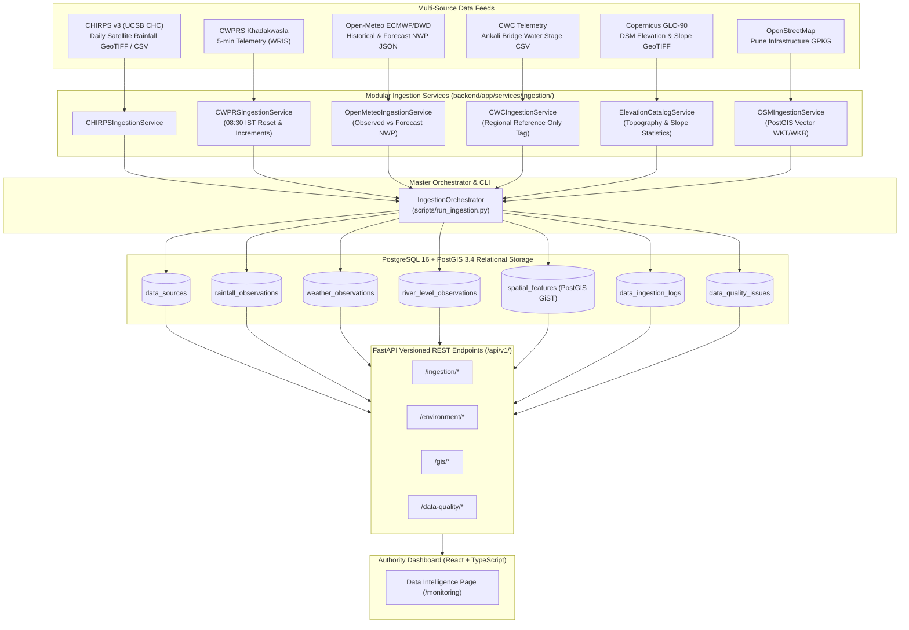

# FLOOD-X — Data Ingestion & Storage Architecture
**Phase 1, Stage 2 System Documentation**
**Geographic Domain**: Pune / Mula-Mutha River Basin, Maharashtra, India

---

## 1. Executive Summary

The FLOOD-X Data Ingestion & Storage Architecture provides the resilient, multi-source data spine for the PCCOE International Grand Challenge 2026. Built on **PostgreSQL 16** with **PostGIS 3.4**, the architecture is designed to ingest, validate, classify, and query heterogeneous hydrological, meteorological, and geospatial infrastructure data across diverse formats (CSV telemetry, GeoTIFF rasters, Cloud-Optimized GeoTIFFs, NetCDF/JSON numerical weather models, and OGC GeoPackage vector layers).

A primary architectural mandate of Stage 2 is strict enforcement of **data provenance**, **semantic integrity**, and **domain invariants**. Specifically, the system transparently logs data limitations (e.g., bucket resets, non-continuous satellite sequences, geographic displacements) without discarding raw evidence or fabricating artificial observations.

---

## 2. Ingestion Pipeline Architecture



---

## 3. Relational & PostGIS Spatial Schema

The database models are implemented using SQLAlchemy 2.0 ORM with GeoAlchemy2 and migrated via Alembic (`backend/alembic/versions/2026_11_04_1553-73d0ff3ddcf9_create_phase1_stage2_ingestion_tables.py`).

### 3.1 `data_sources`
Catalog of all multi-source telemetry feeds and datasets.

| Column | Type | Constraints / Description |
|---|---|---|
| `id` | INTEGER | Primary Key |
| `source_name` | VARCHAR(100) | Unique identifier (e.g. `CWPRS_KHADAKWASLA`, `CHIRPS_V3_RAINFALL`) |
| `source_type` | VARCHAR(50) | `SATELLITE_RAINFALL`, `GROUND_TELEMETRY`, `NUMERICAL_WEATHER_PREDICTION`, `RIVER_LEVEL_TELEMETRY`, `GIS_VECTOR`, `RASTER_ELEVATION` |
| `provider` | VARCHAR(150) | Official agency/data provider |
| `description` | TEXT | Detailed provenance, resolution, and spatial bounds |
| `data_format` | VARCHAR(50) | `CSV`, `GeoTIFF`, `JSON`, `GeoPackage` |
| `units` | VARCHAR(50) | Primary metric units |
| `temporal_resolution` | VARCHAR(50) | e.g. `DAILY`, `5-MIN`, `HOURLY`, `STATIC` |
| `spatial_resolution` | VARCHAR(50) | e.g. `0.05 deg`, `90m`, `VECTOR`, `POINT` |
| `is_active` | BOOLEAN | Operational status |
| `metadata_json` | JSONB / JSON | File catalogs, bounding boxes, sensor zero-gauge datums |
| `created_at` / `updated_at` | TIMESTAMPTZ | Automatic UTC audit timestamps |

### 3.2 `rainfall_observations`
Ingests ground rainfall telemetry, satellite observations, derived increments, and hourly totals.

| Column | Type | Constraints / Description |
|---|---|---|
| `id` | INTEGER | Primary Key |
| `source_id` | INTEGER | Foreign Key -> `data_sources.id` (CASCADE) |
| `station_name` | VARCHAR(150) | Station or aggregate entity name |
| `latitude` / `longitude` | FLOAT | Geographic coordinates (WGS84) |
| `observation_time` | TIMESTAMPTZ | Timestamp normalized to UTC |
| `rainfall_value` | FLOAT | Measured or derived rainfall value |
| `rainfall_unit` | VARCHAR(20) | e.g. `mm`, `mm/day` |
| `measurement_type` | VARCHAR(50) | `5MIN_CUMULATIVE`, `INCREMENTAL`, `HOURLY_ACCUMULATION`, `DAILY_ACCUMULATION` |
| `quality_flag` | VARCHAR(30) | `VALID`, `DERIVED`, `SUSPECT`, `INVALID`, `MISSING`, `INCOMPLETE` |
| `metadata_json` | JSONB / JSON | Raw column names, bucket reset markers, epoch labels |

*Unique Index*: `(source_id, station_name, observation_time, measurement_type)`

### 3.3 `weather_observations`
Stores numerical weather prediction surface variables and soil layer moisture.

| Column | Type | Constraints / Description |
|---|---|---|
| `id` | INTEGER | Primary Key |
| `source_id` | INTEGER | Foreign Key -> `data_sources.id` (CASCADE) |
| `location_name` | VARCHAR(150) | Study centroid (e.g. `Pune, Maharashtra`) |
| `latitude` / `longitude` | FLOAT | 18.5204° N, 73.8567° E |
| `observation_time` | TIMESTAMPTZ | Normalized UTC timestamp |
| `data_category` | VARCHAR(20) | `OBSERVED` (reanalysis) or `FORECAST` (NWP model) |
| `temperature` | FLOAT | 2m Air Temperature (°C) |
| `relative_humidity` | FLOAT | Relative Humidity (%) |
| `precipitation` | FLOAT | Precipitation (mm) |
| `wind_speed` / `direction` | FLOAT | 10m Wind Speed (km/h) & Direction (degrees) |
| `soil_moisture` | FLOAT | Volumetric Soil Moisture 0–7cm (m³/m³) |
| `quality_flag` | VARCHAR(30) | `VALID`, `SUSPECT`, `INVALID` |

*Unique Index*: `(source_id, location_name, observation_time, data_category)`

### 3.4 `river_level_observations`
Ingests river stage telemetry with geographic relevance tags.

| Column | Type | Constraints / Description |
|---|---|---|
| `id` | INTEGER | Primary Key |
| `source_id` | INTEGER | Foreign Key -> `data_sources.id` (CASCADE) |
| `station_name` | VARCHAR(150) | e.g. `Ankali Bridge (Sangli)` |
| `river_name` | VARCHAR(100) | `Krishna` |
| `station_code` | VARCHAR(50) | WRIS Station Code (e.g. `SW_007`) |
| `latitude` / `longitude` | FLOAT | 16.8028° N, 74.5664° E |
| `observation_time` | TIMESTAMPTZ | Normalized UTC timestamp |
| `water_level` | FLOAT | Water level in meters above MSL |
| `level_unit` | VARCHAR(20) | `m` |
| `vertical_datum` | VARCHAR(50) | `MSL` |
| `geographic_relevance` | VARCHAR(50) | `REGIONAL_REFERENCE_ONLY`, `WITHIN_PILOT_BASIN`, `UPSTREAM_DOWNSTREAM` |
| `quality_flag` | VARCHAR(30) | `VALID`, `SUSPECT`, `INVALID` |

*Unique Index*: `(source_id, station_name, observation_time)`

### 3.5 `spatial_features`
Stores PostGIS spatial geometries for Pune waterways, bridges, critical facilities, and roads.

| Column | Type | Constraints / Description |
|---|---|---|
| `id` | INTEGER | Primary Key |
| `source_id` | INTEGER | Foreign Key -> `data_sources.id` (CASCADE) |
| `feature_type` | VARCHAR(50) | `WATERWAY`, `BRIDGE`, `HEALTHCARE`, `EDUCATION`, `COMMUNITY_CIVIC`, `EVACUATION_ROAD` |
| `osm_id` | VARCHAR(50) | OpenStreetMap node/way identifier |
| `name` | VARCHAR(255) | Name of bridge, hospital, river, or highway |
| `properties_json` | JSONB / JSON | Raw OSM tags (lanes, maxspeed, bed count, operator) |
| `geom` | GEOMETRY(4326) | PostGIS native spatial geometry with **GiST Spatial Index** |

*Unique Index*: `(source_id, feature_type, osm_id)`

### 3.6 `data_ingestion_logs`
Tracks end-to-end execution of batch jobs, files read, inserted counts, skipped duplicates, and errors.

### 3.7 `data_quality_issues`
Persistent registry of documented data caveats, spatial offsets, and semantic rules with severity tags (`CRITICAL`, `HIGH`, `MEDIUM`, `LOW`, `INFO`).

---

## 4. Current Ingested Database Record Statistics

Verified against live PostgreSQL 16 PostGIS database:

| Entity Table | Total Records | Breakdown / Notes |
|---|---|---|
| **data_sources** | **6** | CHIRPS, CWPRS, Open-Meteo, CWC, OSM, Copernicus GLO-90 |
| **rainfall_observations** | **50,735** | 24,211 raw 5-min cumulative; 24,211 incremental; 2,288 hourly; 25 daily CHIRPS |
| **river_level_observations** | **32,655** | 100% categorized as `REGIONAL_REFERENCE_ONLY` |
| **spatial_features** | **1,307** | 906 Evacuation Roads, 185 Healthcare, 158 Bridges, 30 Schools, 21 Waterways, 7 Civic |
| **weather_observations** | **456** | 288 Observed Reanalysis hours + 168 Forecast NWP hours |
| **data_quality_issues** | **8** | Documented semantic and geographic invariants |
| **data_ingestion_logs** | **8** | Full audit trail of all ingestion executions |

---

## 5. CLI Execution & Verification

The pipeline is managed via the automated CLI runner:

```bash
# Run status audit
python scripts/run_ingestion.py --status

# Run individual source pipeline
python scripts/run_ingestion.py --source cwprs
python scripts/run_ingestion.py --source chirps
python scripts/run_ingestion.py --source open_meteo
python scripts/run_ingestion.py --source cwc
python scripts/run_ingestion.py --source osm
python scripts/run_ingestion.py --source elevation

# Run full end-to-end multi-source pipeline
python scripts/run_ingestion.py --all
```

