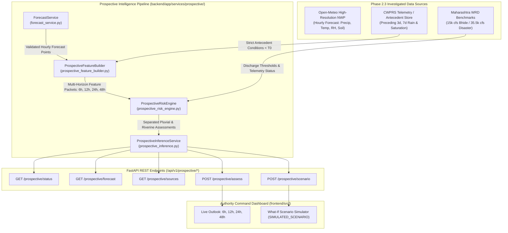

# FLOOD-X — PHASE 2.3 PROSPECTIVE ARCHITECTURE SPECIFICATION

**Project:** FLOOD-X — AI-Powered Flood Intelligence & Emergency Decision Support Platform  
**Pilot Basin:** Pune / Mula-Mutha River Basin (18.40°N–18.65°N, 73.70°E–74.05°E), Maharashtra, India  
**Phase:** Phase 2.3 — Prospective Flood-Risk Intelligence & Forecast Integration  
**Date:** November 2026  
**Status:** IMPLEMENTED & VERIFIED  

---

## 1. ARCHITECTURAL OVERVIEW

The FLOOD-X prospective flood intelligence architecture is designed as a separate, modular pipeline decoupled from the retrospective daily diagnostic classifier. It integrates forward-looking Numerical Weather Prediction (NWP) forecasts, antecedent soil and precipitation telemetry, and upstream reservoir discharge reference benchmarks to deliver explainable early-warning assessments.

---

## 2. MODULAR SERVICE ARCHITECTURE

The prospective pipeline is organized in `backend/app/services/prospective/`:

### 1. `forecast_service.py` (`ForecastService`)
- Fetches and parses Open-Meteo high-resolution hourly forecast feeds (168-hour horizon).
- Enforces strict timestamp conversions (Asia/Kolkata local time to UTC ISO8601).
- Provides resilient failover: attempts live API retrieval (timeout: 4.0s); falls back cleanly to the verified local forecast batch (`data/raw/weather/open_meteo_forecast_pune.json`) if offline or rate limited.
- Serializes strongly typed `ForecastHourlyPoint` records.

### 2. `dam_telemetry_service.py` (`DamTelemetryService`)
- Tracks the operational status of Khadakwasla Dam spillway telemetry.
- Formally registers that no public unauthenticated streaming REST API is published by Maharashtra WRD; live automated feeds are designated `DATA_INSUFFICIENT`.
- Maintains canonical municipal discharge benchmarks:
  - **15,000 cfs:** Baba Bhide Bridge causeway submergence threshold.
  - **25,000 cfs:** Pulachi Wadi / Deccan Gymkhana riverbank overbank flow warning.
  - **35,574 cfs:** July 25, 2024 peak disaster benchmark (Sinhagad Road / Ekta Nagari severe residential flooding).
  - **50,000+ cfs:** Level-4 extreme catchment flood.
- Evaluates simulated discharge scenarios.

### 3. `prospective_feature_builder.py` (`ProspectiveFeatureBuilder`)
- Constructs multi-horizon feature vectors across four canonical outlook windows: **6 hours, 12 hours, 24 hours, and 48 hours**.
- **Strict Temporal Isolation & Zero Leakage:**
  - Forward forecast metrics (accumulation, peak 1h intensity, peak 3h/6h volume, pressure drop) are calculated **strictly from forecast points within $[T_0, T_0 + H]$**.
  - Backward antecedent metrics (preceding 3d and 7d rainfall, surface soil moisture, Vertisol saturation ratio) are calculated **strictly from observations prior to $T_0$**.
  - Antecedent conditions are identical across all forecast horizons, preventing future forecast conditions from contaminating baseline catchment wetness.

### 4. `prospective_risk_engine.py` (`ProspectiveRiskEngine`)
- Implements an explainable, physics-informed, rule-based decision engine with documented engineering thresholds.
- **Strict Separation of Mechanisms:**
  - **Urban Pluvial Risk:** Compares peak forecast 1h rain intensity against Pune municipal storm drainage absorption limit ($25\text{ mm/h}$) and evaluates 3h/6h accumulation modulated by Vertisol soil saturation.
  - **Riverine Risk:** Evaluates Khadakwasla Dam release rates against physical benchmarks. If real-time telemetry is missing and no scenario is supplied, riverine risk is classified as `DATA_INSUFFICIENT`.
- Synthesizes composite horizon guidance with a mandatory human verification requirement flag.

### 5. `prospective_inference.py` (`ProspectiveInferenceService`)
- Orchestrates multi-horizon evaluations for live operational outlooks and What-If emergency scenarios.
- Tags all hypothetical simulations with `is_simulated = True` and `simulation_tag = "SIMULATED_SCENARIO"`.
- Serves the investigated data sources catalog and metadata provenance.

---

## 3. MULTI-HORIZON PREDICTION WINDOW SPECIFICATION

| Horizon | Lead Time | Operational Purpose | Key Predictive Metrics |
|---|---|---|---|
| **6-Hour Outlook** | $T+1\text{h}$ to $T+6\text{h}$ | **Immediate Pluvial Flash-Flood & Underpass Warning** | Peak 1h intensity (mm/h), 3h volume, drainage capacity exceedance |
| **12-Hour Outlook** | $T+1\text{h}$ to $T+12\text{h}$ | **Half-Day Municipal Shift Planning & Sluice Gate Alert** | 6h volume, convective burst duration, soil moisture deficit exhaustion |
| **24-Hour Outlook** | $T+1\text{h}$ to $T+24\text{h}$ | **Full-Day Watershed Response & Causeway Inundation** | 24h accumulation (mm), antecedent 3d rain, Bhide submergence check |
| **48-Hour Outlook** | $T+1\text{h}$ to $T+48\text{h}$ | **Extended Monsoon Synoptic Watch & Reservoir Inflow** | Multi-day accumulation, pressure trend, regional monsoon depression tracking |

---

## 4. ISOLATION BETWEEN RETROSPECTIVE AND PROSPECTIVE PIPELINES

| Pipeline Property | Retrospective Pipeline (Phase 2.2 / 2.2.1) | Prospective Pipeline (Phase 2.3) |
|---|---|---|
| **Prediction Task** | `RETROSPECTIVE_DAILY_DIAGNOSTIC` | `PROSPECTIVE_EARLY_WARNING` |
| **Primary Input Data** | Completed 24h historical reanalysis & daily observations (00:00–23:59 UTC) | Forward-looking hourly Numerical Weather Prediction forecasts |
| **Decision Engine** | Supervised Tree Ensembles (Random Forest Balanced, XGBoost) | Physics-informed, explainable, rule-based decision engine |
| **Target Question** | "Did completed environmental forcing trigger basin inundation?" | "Will forecast rainfall and dam releases exceed drainage and channel limits?" |
| **Dam Discharge Handling** | Implicit in historical ground-truth flood disaster labels | Separated riverine mechanism with explicit discharge benchmarks & scenario inputs |
| **API Endpoints** | `/api/v1/ml/*` | `/api/v1/prospective/*` |
| **Frontend Location** | `/risk` (Retrospective Benchmark Tab) | `/risk` (Prospective Intelligence & Scenario Tabs) |

