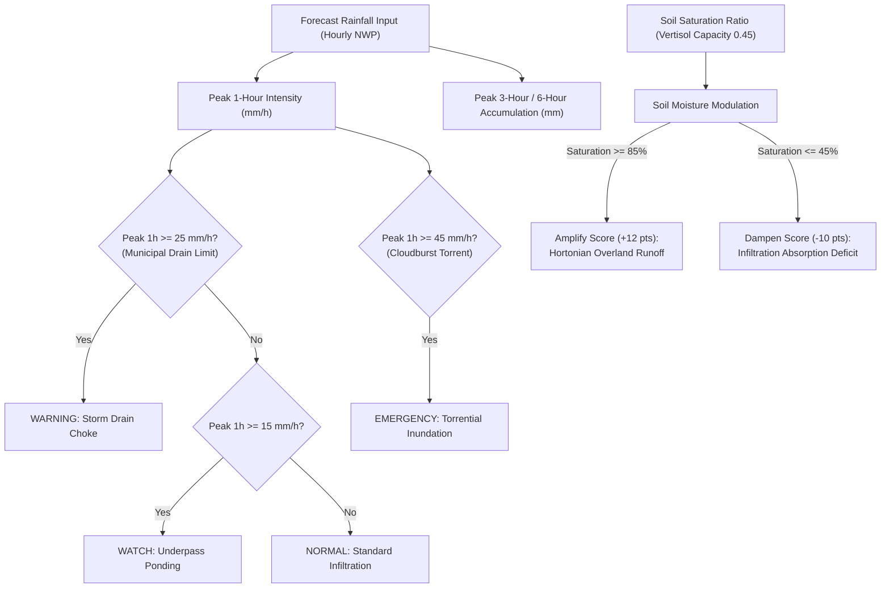

# FLOOD-X — PHASE 2.3 PROSPECTIVE RISK DECISION ENGINE SPECIFICATION

**Project:** FLOOD-X — AI-Powered Flood Intelligence & Emergency Decision Support Platform  
**Pilot Basin:** Pune / Mula-Mutha River Basin (18.40°N–18.65°N, 73.70°E–74.05°E), Maharashtra, India  
**Phase:** Phase 2.3 — Prospective Flood-Risk Intelligence & Forecast Integration  
**Date:** November 2026  
**Status:** IMPLEMENTED & AUDITED  

---

## 1. SCIENTIFIC DETERMINATION: MACHINE LEARNING VS. RULE-BASED DECISION ENGINE

A foundational requirement of Phase 2.3 was determining whether the available historical records could scientifically support **supervised prospective machine learning**.

### Why Prospective Supervised Learning is Currently Infeasible:
1. **Absence of Archived Operational NWP Forecast Cycles:**  
   The historical training dataset (2020–2024) consists of continuous **reanalysis and analysis observations** (ERA5-Land and Open-Meteo archive), representing true analyzed atmospheric states. It does **not** contain archived operational forecast runs issued at discrete lead times ($T-6\text{h}, T-12\text{h}, T-24\text{h}, T-48\text{h}$) with empirical forecast bias and error cones. Training a prospective model on perfect reanalysis and claiming it represents future forecast skill constitutes severe synthetic bias.
2. **Coarse Daily Ground-Truth Onset Labels:**  
   The India Flood Inventory (IFI) records flood events as calendar dates (e.g., "July 25, 2024"). Sub-daily flood onset timestamps (e.g., 04:30 IST when Khadakwasla discharge crossed 30,000 cfs, or 21:00 IST when Ambil Odha breached) are not recorded in official tabular registers. A prospective forward model requiring sub-daily lead horizons (6h, 12h) cannot be supervised without verified hourly inundation onset telemetry.
3. **Severe Event Scarcity ($N=11$ Physical Events):**  
   Over 5 continuous years (1,827 days), only 11 unique physical flood events occurred in Pune. Partitioning these rare events into train, validation, and test splits across multiple lead horizons yields single-event evaluation sets, where variance dwarfs statistical significance.

### Scientific Decision:
In accordance with strict hackathon directives:  
> *"If reliable prospective training labels are insufficient, implement a transparent, rule-based experimental forecast risk engine instead. A rule-based engine is preferable to a fabricated ML model."*

FLOOD-X has implemented a **transparent, physics-informed, rule-based prospective decision engine** with documented hydrometeorological thresholds, distinguishing measured from forecast data and separating flood mechanisms.

---

## 2. URBAN PLUVIAL FLOOD RISK LOGIC

Urban pluvial flooding in Pune is governed by convective rainfall intensity overwhelming localized stormwater drainage networks and natural nalas (e.g., Ambil Odha, Nagzari, Manik Nullah):

### Documented Pluvial Engineering Thresholds:
- **Municipal Storm Drain Design Capacity:** $25.0\text{ mm/h}$ (standard PMC storm sewer absorption capacity). Any intensity exceeding this rate creates localized street ponding and underpass flooding.
- **Convective Cloudburst Threshold:** $\ge 45.0\text{ mm/h}$ (e.g., September 2019 Sahakar Nagar / Ambil Odha flash torrent). Generates immediate supercritical open-channel velocities in natural nalas.
- **Multi-Hour Accumulation Thresholds:** 3h volume $\ge 50.0\text{ mm}$ or 6h volume $\ge 75.0\text{ mm}$ saturates municipal detention basins.
- **Vertisol Soil Moisture Modulation:**
  - When $\text{Saturation Ratio} \ge 0.85$, Black Cotton Vertisol soil moisture deficit is exhausted; rainfall converts immediately to Hortonian and Dunne surface runoff.
  - When $\text{Saturation Ratio} \le 0.45$, dry Vertisol crack networks absorb the initial $15 - 25\text{ mm}$ of precipitation, delaying urban runoff.

---

## 3. RIVERINE FLOOD RISK LOGIC & KHADAKWASLA DAM GOVERNANCE

Riverine flooding along the Mula-Mutha corridor through central Pune is predominantly controlled by upstream spillway discharge from the **Khadakwasla Dam** ($18.4419^\circ\text{N}, 73.7667^\circ\text{E}$), which receives water from the upper Western Ghats cascade reservoirs (Panshet, Varasgaon, Temghar).

### The Live Telemetry Reality:
- Maharashtra WRD publishes daily storage tables via `wrd.maharashtra.gov.in` and mobile app, but **does not expose a public unauthenticated streaming REST API**.
- Real-time flood releases are communicated via emergency telephone/wireless dispatches to the Pune Municipal Corporation (PMC) Disaster Management Cell.
- **Zero-Fabrication Enforcement:** When live dam telemetry is unavailable, riverine risk is strictly classified as **`DATA_INSUFFICIENT`** with explicit physical reasoning explaining that river stage cannot be predicted without upstream discharge rates.

### Canonical Physical Reference Benchmarks:

| Dam Discharge Rate (cfs) | Risk Tier | Municipal Physical Impact Benchmark | Key Vulnerable Corridors |
|---|---|---|---|
| **$< 5,000\text{ cfs}$** | `NORMAL` | Base environmental release; water confined to inner low-flow channel. | None. |
| **$5,000 - 14,999\text{ cfs}$** | `WATCH` | Channel bankfull flow; water approaches Baba Bhide causeway road deck. | Deccan Gymkhana riverside parking. |
| **$15,000 - 24,999\text{ cfs}$** | `WARNING` | **Baba Bhide Bridge causeway submerged.** PMC traffic police close causeway to vehicular traffic. | Baba Bhide Bridge, riverside causeways. |
| **$25,000 - 35,573\text{ cfs}$** | `WARNING` | Inner riverbanks overtopped; water enters low-income settlements. | Pulachi Wadi, Deccan Gymkhana riverside shanties. |
| **$35,574\text{ cfs}$** | `EMERGENCY` | **July 25, 2024 Verified Disaster Peak.** Extreme backwater pooling behind river retaining walls; residential ground floors flooded $1.5 - 2.5\text{ m}$. | Sinhagad Road (Ekta Nagari, Anand Nagar, Sharada Math). |
| **$\ge 50,000\text{ cfs}$** | `EMERGENCY` | **Level-4 Extreme Catastrophic Disaster.** Multi-ward floodplain inundation. | Deccan, Sangam, Sangamwadi, Yerwada, PCMC Sangvi. |

---

## 4. WHAT-IF EMERGENCY SCENARIO ANALYSIS ENGINE

To bridge the gap caused by the lack of an open live dam telemetry API, FLOOD-X incorporates an interactive **What-If Emergency Scenario Simulator**:
1. Allows municipal disaster managers to test custom hypothetical conditions:
   - Rainfall Scaling Multiplier ($0.5\times$ to $4.0\times$)
   - Forced Peak 1-Hour Rain Intensity ($0$ to $80\text{ mm/h}$)
   - Simulated Khadakwasla Dam Spillway Discharge ($0$ to $60,000\text{ cfs}$)
   - Pre-event Surface Soil Moisture ($0.15$ to $0.52\text{ m}^3/\text{m}^3$)
2. **Strict Guardrails:** Every scenario output is explicitly tagged `is_simulated = True` and carries the prominent badge `SIMULATED_SCENARIO` alongside a warning that outputs represent exploratory simulations and must never be cited as certified field forecasts.

