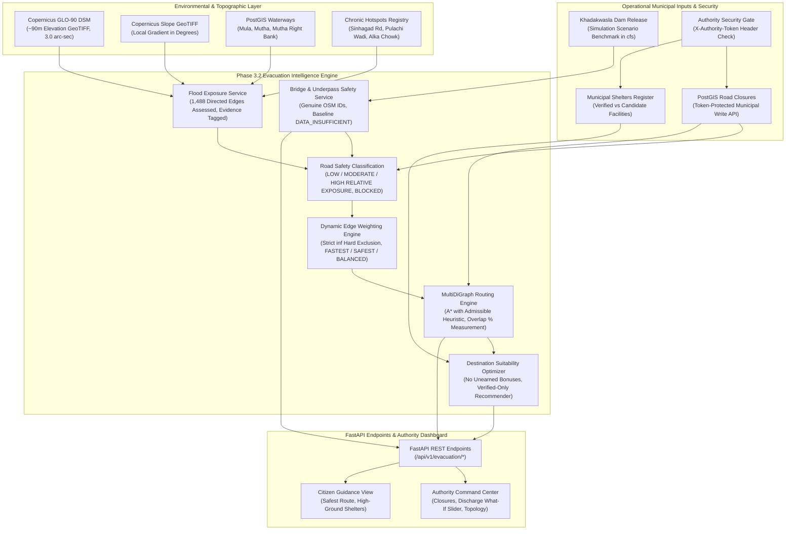

# FLOOD-X — PHASE 3.2: EVACUATION INTELLIGENCE SUBSYSTEM ARCHITECTURE
## Audited & Corrected Implementation: Scientific Integrity, Data Provenance & Evacuation Safety Validation

## 1. Executive Summary & Purpose

Phase 3.2 completes the transition from static road network topology (Phase 3.1 & 3.1.1) to an **active, flood-aware evacuation intelligence and decision-support subsystem** for the Pune / Mula-Mutha River Basin.

Following an independent scientific and data provenance audit, Phase 3.2 was corrected to eliminate unsupported assumptions, enforce strict data provenance, adhere to true sensor resolutions, and ensure operational safety in routing and facility management.

The subsystem connects environmental intelligence (Copernicus GLO-90 DSM terrain elevation, local slope, PostGIS river corridors, chronic flood hotspots) with operational constraints (authorized municipal road closures, Khadakwasla Dam discharge simulations) and civil defense assets (verified municipal shelters, candidate relief facilities) on top of the validated NetworkX `MultiDiGraph` (1,067 nodes, 1,488 directed edges, 89 weakly connected components).

---

## 2. High-Level Subsystem Architecture

---

## 3. Database Schema Design (PostgreSQL / PostGIS)

Phase 3.2 introduces 4 dedicated relational tables managed under Alembic migrations `482a93df1b7c` and `59a8c1e2f3d4`:

### 3.1. `road_closures`
Tracks official municipal barricades, structural hazards, and waterlogging closures:
- `id` (SERIAL PRIMARY KEY)
- `edge_id` (VARCHAR(64), indexed): Graph edge identifier referencing `MultiDiGraph` edges (`u_v_key`).
- `road_name` (VARCHAR(255))
- `closure_status` (VARCHAR(32)): `CONFIRMED_BLOCKED`, `PROVISIONALLY_CLOSED`, `CLEARED`.
- `closure_type` (VARCHAR(64)): `FLOOD_SUBMERGENCE`, `POLICE_BARRICADE`, `STRUCTURAL_HAZARD`.
- `reason` (TEXT): Specific incident reason (e.g., "Khadakwasla release waterlogging 0.6m").
- `verification_source` (VARCHAR(128))
- `reporting_authority` (VARCHAR(128)): e.g., "Pune Traffic Police Unit 1", "PMC Disaster Management Cell".
- `operator_notes` (TEXT)
- `is_active` (BOOLEAN, default TRUE, indexed)
- `effective_from`, `effective_to` (TIMESTAMPTZ)
- `created_at`, `updated_at` (TIMESTAMPTZ)

### 3.2. `shelters`
Maintains relief camps, community centers, and municipal schools with explicit verification tiers and strict data provenance:
- `id` (SERIAL PRIMARY KEY)
- `facility_id` (VARCHAR(64), unique, indexed)
- `osm_id` (VARCHAR(32), nullable)
- `name` (VARCHAR(255), not null)
- `facility_type` (VARCHAR(64)): `COMMUNITY_CENTRE`, `RELIEF_CAMP`, `SCHOOL`, `SPORTS_COMPLEX`, `HOSPITAL`.
- `verification_status` (VARCHAR(32)): `VERIFIED_SHELTER`, `CANDIDATE_SHELTER`, `UNVERIFIED_FACILITY`, `INACTIVE_SHELTER`.
- `address` (TEXT)
- `latitude`, `longitude` (FLOAT, not null)
- `total_capacity` (INTEGER, nullable): Preserves `None` when capacity has not been formally gazetted or verified by municipal authorities.
- `current_occupancy` (INTEGER, nullable): Preserves `None` when headcount telemetry or operational headcount is unavailable.
- `available_capacity` (INTEGER, nullable)
- `has_medical_support`, `is_wheelchair_accessible`, `has_generator_power` (BOOLEAN)
- `emergency_contact`, `source`, `verified_by` (VARCHAR)
- `evidence_document` (VARCHAR(255), nullable): Official municipal gazette / administrative order reference number.
- `evidence_date` (DATE, nullable): Date of municipal verification or inspection order.
- `verified_at`, `created_at`, `updated_at` (TIMESTAMPTZ)

### 3.3. `shelter_update_history`
Maintains audit trail of all capacity, occupancy, and status updates:
- `id` (SERIAL PRIMARY KEY)
- `shelter_id` (INTEGER, FOREIGN KEY to `shelters.id` ON DELETE CASCADE)
- `update_type` (VARCHAR(64))
- `previous_value`, `new_value` (TEXT)
- `updated_by` (VARCHAR(128))
- `notes` (TEXT)
- `created_at` (TIMESTAMPTZ)

### 3.4. `evacuation_audit_logs`
System-wide audit trail for emergency operator actions:
- `id` (SERIAL PRIMARY KEY)
- `event_type` (VARCHAR(64)): `ROAD_CLOSURE_CREATED`, `ROAD_CLOSURE_DELETED`, `SHELTER_VERIFIED`, `SHELTER_DELETED`.
- `entity_type` (VARCHAR(64)): `ROAD_CLOSURE`, `SHELTER`, `BRIDGE_ALERT`.
- `entity_id` (VARCHAR(64))
- `actor` (VARCHAR(128))
- `details_json` (TEXT)
- `created_at` (TIMESTAMPTZ)

---

## 4. Administrative Security Architecture (Security Hardened)

To prevent unauthorized modification of life-critical emergency infrastructure (e.g. malicious road closure creation or fake shelter status elevation), all state-modifying REST endpoints enforce role/token authentication:

- **Security Gate**: FastAPI dependency `require_admin_authority` (`verify_authority_token`).
- **Header**: `X-Authority-Token` (or `Authorization: Bearer <token>`).
- **Configuration**: Loaded exclusively from protected environment variable `FLOODX_AUTHORITY_TOKEN` (or `EVACUATION_AUTHORITY_TOKEN`). Hardcoded secrets and fallback defaults are strictly prohibited.
- **Fail-Closed Policy**: If the server credential configuration is missing, all administrative write requests fail closed with `503 Service Unavailable`.
- **Timing Defense**: Constant-time token comparison (`hmac.compare_digest`) prevents timing side-channel attacks.
- **Server-Established Roles**: Roles (`ADMIN`, `OPERATOR`, `VIEWER`) are resolved server-side from credentials. Frontend-supplied roles are never trusted.
- **Audit Attribution**: Operations record the authenticated actor (e.g., `Disaster Management Administrator`) in `evacuation_audit_logs`.
- **Credential Protection**: Tokens are never logged and never reflected in error messages or response bodies.
- **Error Responses**:
  - `401 Unauthorized`: Missing authentication credentials.
  - `403 Forbidden`: Invalid, rotated, or insufficient privileges (e.g., non-admin role).
  - `503 Service Unavailable`: Server authority configuration missing (fail-closed).
- **Protected Endpoints**:
  - `POST /api/v1/evacuation/closures`
  - `PATCH /api/v1/evacuation/closures/{id}`
  - `DELETE /api/v1/evacuation/closures/{id}`
  - `POST /api/v1/evacuation/shelters`
  - `PATCH /api/v1/evacuation/shelters/{id}`
  - `DELETE /api/v1/evacuation/shelters/{id}`
- **Public Endpoints**: All read-only query endpoints (`GET`) remain publicly accessible for citizen and civil protection consumption.

---

## 5. REST API Endpoint Specification (`/api/v1/evacuation/*`)

| Method | Endpoint | Description | Security | Status Code |
| :--- | :--- | :--- | :--- | :--- |
| `GET` | `/api/v1/evacuation/status` | Aggregated subsystem operational readiness and edge counts | Public | 200 OK |
| `GET` | `/api/v1/evacuation/statistics` | Distribution of exposure tiers, safety classifications, and shelter capacity | Public | 200 OK |
| `GET` | `/api/v1/evacuation/roads/exposure` | Paginated list of road graph edges with GLO-90 DSM elevations, slope, and exposure tier | Public | 200 OK |
| `GET` | `/api/v1/evacuation/roads/{edge_id}/safety` | Detailed operational safety record for single edge | Public | 200 OK / 404 |
| `GET` | `/api/v1/evacuation/infrastructure` | Real-time and simulated flood safety status for monitored Pune bridges | Public | 200 OK |
| `GET` | `/api/v1/evacuation/infrastructure/{id}` | Status record for single bridge or underpass | Public | 200 OK / 404 |
| `GET` | `/api/v1/evacuation/closures` | List of municipal road closures and barricades (`active_only` filter) | Public | 200 OK |
| `POST` | `/api/v1/evacuation/closures` | Register official municipal closure (dynamically excludes graph edges) | `X-Authority-Token` | 201 Created / 401 / 403 |
| `PATCH` | `/api/v1/evacuation/closures/{id}` | Update closure status or notes | `X-Authority-Token` | 200 OK / 401 / 403 / 404 |
| `DELETE`| `/api/v1/evacuation/closures/{id}` | Lift / clear road closure and log audit trail | `X-Authority-Token` | 200 OK / 401 / 403 / 404 |
| `POST` | `/api/v1/evacuation/routes/plan` | Plan primary and alternative flood-aware evacuation routes on MultiDiGraph | Public | 200 OK |
| `GET` | `/api/v1/evacuation/shelters` | Query emergency relief centers with capacity, status, and amenity filters | Public | 200 OK |
| `POST` | `/api/v1/evacuation/shelters` | Register new verified municipal shelter | `X-Authority-Token` | 201 Created / 401 / 403 |
| `PATCH` | `/api/v1/evacuation/shelters/{id}` | Update shelter capacity, occupancy, or verification status | `X-Authority-Token` | 200 OK / 401 / 403 / 404 |
| `DELETE`| `/api/v1/evacuation/shelters/{id}` | Deactivate or delete shelter record | `X-Authority-Token` | 200 OK / 401 / 403 / 404 |
| `GET` | `/api/v1/evacuation/shelters/recommendations` | Rank verified shelters for origin coordinates; returns candidate review if 0 verified | Public | 200 OK |

---

## 6. Non-Destructive Dynamic Graph Weighting & Hard Edge Exclusion

A core architectural principle of FLOOD-X is that **environmental hazards and municipal closures never mutate baseline graph attributes**.

The underlying NetworkX `MultiDiGraph` maintains immutable physical measurements:
- Physical segment length in meters ($L$).
- Baseline speed limits ($v$).
- Free-flow travel time ($t_0 = L / v$).
- Elevation layer index (`layer` = -1, 0, 1).
- Genuine intersection topology.

### 6.1. Dynamic Cost Formulation
When routing algorithms execute, `DynamicEdgeWeightCalculator` computes an instantaneous traversal cost:
$$\text{Cost}(e) = t_0(e) \times M_{\text{hazard}}(\text{tier}, \text{profile}) + P_{\text{directionality}} + P_{\text{alternative}}$$

### 6.2. Strict Hard Exclusion of Closed Roads
If an edge is currently blocked by an active municipal road closure and `avoid_closed_roads=True`:
- `DynamicEdgeWeightCalculator` returns $\text{Cost}(e) = \infty$ (`float('inf')`).
- Pathfinding algorithms (Dijkstra and A*) explicitly skip infinite-cost edges with a hard `continue` check.
- **Parallel Edge MultiDiGraph Safety**: If a physical road segment has multiple parallel directed edges (e.g., dual carriageway lanes or distinct turning movements), only the closed edge key is excluded. If an open parallel edge exists between node $u$ and node $v$, it remains traversable. If all parallel edges between $u$ and $v$ are blocked, the neighbor is completely unreachable. If all routes from origin to destination are blocked by closures, the routing engine terminates cleanly and returns `status = "NO_PATH"` with an explicit error message.
