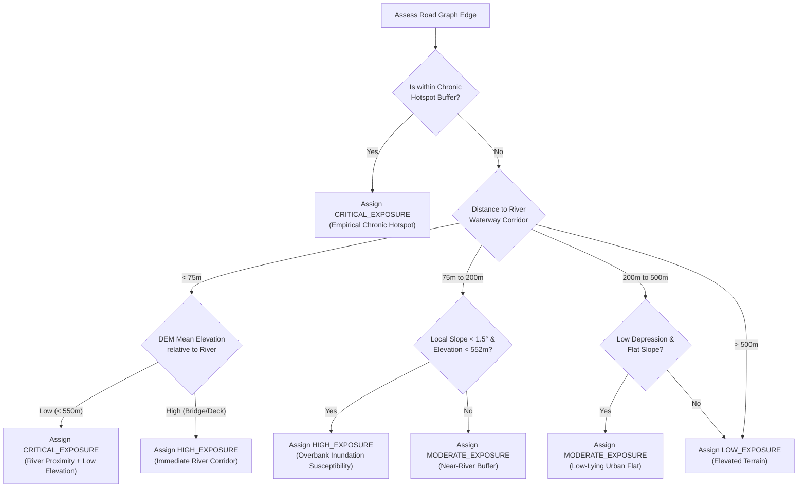

# FLOOD-X — PHASE 3.2: FLOOD HAZARD EXPOSURE & ROAD SAFETY CLASSIFICATION
## Audited & Corrected Implementation: Terrain Susceptibility, Data Provenance & Infrastructure Monitoring

## 1. Environmental Exposure Modeling Methodology & Data Provenance

FLOOD-X Phase 3.2 evaluates flood hazard exposure across all 1,488 directed edges in the Pune arterial road network by cross-referencing topographic rasters, local slope derivatives, PostGIS river centerlines, and chronic municipal flood hotspots.

### 1.1. Sensor Resolution & Elevation Model Provenance (Copernicus GLO-90 DSM)

> [!IMPORTANT]
> **Resolution & Sensor Correction**:
> The primary topographic layer in FLOOD-X is the **Copernicus GLO-90 DSM (Digital Surface Model)** (`copernicus_glo90_pune_basin_dem.tif`).
> - **Spatial Resolution**: $0.0008333333^\circ \approx 3.0\text{ arc-seconds}$ (nominal pixel size: **~90 meters** at Pune latitude $18.52^\circ\text{N}$).
> - **Model Class**: Digital Surface Model (DSM). Unlike a bare-earth Digital Terrain Model (DTM), the DSM records surface elevations including urban buildings, trees, and canopy structures. This introduces an urban surface elevation bias that can overestimate ground elevation in dense built-up city wards.
> - **Correction**: All references claiming "30m DEM" have been audited and corrected.

### 1.2. Input Geospatial Datasets

| Dataset | Source / File | Native Resolution | Role in Terrain Screening |
| :--- | :--- | :--- | :--- |
| **Copernicus GLO-90 DSM** | `copernicus_glo90_pune_basin_dem.tif` | ~90m (3.0 arc-sec) | Minimum, maximum, and mean surface elevation along road geometries |
| **Copernicus Slope Raster**| `copernicus_glo90_pune_basin_slope.tif` | ~90m (degrees) | Local slope identifying flat basin depressions ($\text{slope} < 1.5^\circ$) |
| **OSM Mula-Mutha Waterways**| PostGIS `planet_osm_line` | Vector LineStrings | Perpendicular metric distance from river corridor ($< 75\text{m}$, $< 200\text{m}$, $< 500\text{m}$) |
| **Chronic Flood Hotspots** | PostGIS / Spatial Registry | Point / Vector Buffers | Historical empirical flood zones (Sinhagad Rd, Pulachi Wadi, Alka Chowk) |

---

## 2. Terrain Susceptibility Screening Framework

> [!NOTE]
> **Scientific Classification**:
> The exposure tier engine is explicitly classified as a **Terrain Susceptibility Screening Heuristic** (`TERRAIN_SUSCEPTIBILITY`). It is **not** a calibrated 1D or 2D hydrodynamic inundation model (such as HEC-RAS 2D or TUFLOW), and does not predict dynamic flow velocities, water depths, or time-to-peak inundation.

### 2.1. Evidence Type Categorization
Every edge in the network is tagged with one of five standardized evidence categories:
1. `OBSERVED_HAZARD`: Confirmed in-situ ground report, field sensor, or verified police barricade.
2. `FORECAST_DERIVED_EXPOSURE`: Derived from calibrated numerical meteorological/hydrological forecast.
3. `TERRAIN_SUSCEPTIBILITY`: Rule-based screening from DEM surface elevation, local slope, and river proximity buffers.
4. `SIMULATED_SCENARIO`: User-selected parameter variation (e.g., interactive dam discharge scenario drill).
5. `UNKNOWN_EXPOSURE`: Missing, corrupted, or unvalidated topographic inputs.

### 2.2. Screening Rules & Exposure Tiers

### 2.3. Empirical Baseline Results (1,488 Directed Network Edges)

| Exposure Tier | Count | Percentage | Hydrological Interpretation |
| :--- | :--- | :--- | :--- |
| **CRITICAL_EXPOSURE** | 136 | 9.1% | Riverbank corridors ($<75\text{m}$) below 550m DEM, low causeways, and chronic hotspots. |
| **HIGH_EXPOSURE** | 160 | 10.8% | Overbank flood plains (75m–200m) with flat slope ($< 1.5^\circ$) and elevation $< 552\text{m}$. |
| **MODERATE_EXPOSURE**| 651 | 43.8% | River buffer (200m–500m) with intermediate drainage slopes. |
| **LOW_EXPOSURE** | 541 | 36.3% | Elevated ridges ($> 560\text{m}$), foothill spurs, and well-drained arterial avenues. |
| **TOTAL** | **1,488**| **100.0%**| |

---

## 3. Qualified Road Safety Operational Classification

To prevent false confidence during severe flood events, FLOOD-X rejects unqualified "SAFE" designations and enforces qualified relative exposure labels:

| Operational Status | Criteria | Scientific Meaning & Routing Impact |
| :--- | :--- | :--- |
| **LOW_RELATIVE_EXPOSURE** | Low terrain exposure; elevated ridges; slope $> 1.5^\circ$. | Relatively lower topographical susceptibility in ~90m DSM screening. **Does NOT guarantee dry passage** during intense pluvial cloudbursts or local drain blockages. 1.0x baseline travel time. |
| **MODERATE_RELATIVE_EXPOSURE** | Moderate terrain exposure OR unverified OSM directionality (`is_direction_assumed = True`). | Near-river buffer zone or directionally uncertain arterial. 1.3x–1.5x travel time multiplier in `SAFEST` profile. |
| **HIGH_RELATIVE_EXPOSURE** | Critical or High terrain exposure tier; chronic flood hotspot proximity. | High topographical flood vulnerability. 2.5x–4.0x travel time multiplier in `SAFEST` profile. |
| **CONFIRMED_BLOCKED** | Active municipal road closure or verified waterlogging barricade. | Mathematically impassable. Edge cost set to $\infty$ (`float('inf')`); hard-skipped during pathfinding. |
| **UNKNOWN_STATUS** | Missing or unvalidated topographical / operational data. | Unverified status. Defaults to moderate caution weighting. |

---

## 4. Critical River Bridges & Underpasses: Provenance & Simulation

Central Pune features diverse river crossings and railway underpasses that respond differently to Mutha River flooding and urban pluvial runoff.

### 4.1. Asset Registry & Provenance (Linked to Genuine PostGIS OSM IDs)

All monitored structures are mapped directly to verified PostGIS OpenStreetMap identifiers:

| Asset Name | Asset Type | Genuine OSM ID | Coordinates | Baseline Status | Discharge / Submergence Benchmark |
| :--- | :--- | :--- | :--- | :--- | :--- |
| **Baba Bhide Bridge** | Low-Level Causeway | `53759174` | 18.5178°N, 73.8485°E | `DATA_INSUFFICIENT` | **15,000 cfs** (Unverified Simulation Benchmark) |
| **Sambhaji Bridge (Lakdi Pul)** | High-Level Arterial | `53088328` | 18.5144°N, 73.8488°E | `DATA_INSUFFICIENT` | **40,000 cfs** (Simulation Benchmark) |
| **Shivaji Bridge (Nava Pul)** | Major River Crossing | `22841323` | 18.5245°N, 73.8562°E | `DATA_INSUFFICIENT` | **45,000 cfs** (Simulation Benchmark) |
| **Sangam Bridge** | Confluence Crossing | `53088330` | 18.5303°N, 73.8647°E | `DATA_INSUFFICIENT` | **45,000 cfs** (Simulation Benchmark) |
| **Bund Garden Bridge** | Downstream Outflow | `53088334` | 18.5370°N, 73.8820°E | `DATA_INSUFFICIENT` | **50,000 cfs** (Simulation Benchmark) |
| **Dengle Bridge** | Municipal Crossing | `53088332` | 18.5270°N, 73.8600°E | `DATA_INSUFFICIENT` | **35,000 cfs** (Simulation Benchmark) |
| **Yashwantrao Chavan Bridge** | River Connector | `53088326` | 18.5120°N, 73.8420°E | `DATA_INSUFFICIENT` | **35,000 cfs** (Simulation Benchmark) |
| **Holkar Bridge** | Mula River Crossing | `22841045` | 18.5550°N, 73.8680°E | `DATA_INSUFFICIENT` | **45,000 cfs** (Simulation Benchmark) |
| **Bankimchandra Underpass** | Low-Lying Underpass | `173045975` | 18.5295°N, 73.8510°E | `DATA_INSUFFICIENT` | Pluvial Sump (Chronic Waterlogging Benchmark) |
| **Sangam Rail Underpass** | Railway Subway | `22841049` | 18.5320°N, 73.8650°E | `DATA_INSUFFICIENT` | Pluvial Sump (Chronic Waterlogging Benchmark) |

### 4.2. Scientific Benchmark Status & Telemetry Reality

1. **Baba Bhide Causeway (15,000 cfs Benchmark)**:
   - *Status*: Unverified operational reference from municipal and news archives, used strictly as an **interactive simulation benchmark**.
   - *Submergence Mechanism*: Bhide Bridge is a low-level causeway built without piers directly across the Mutha riverbed. Water covers the deck during moderate dam releases (~15,000 cfs), making it the first crossing closed by Pune Traffic Police.
   - *Hydraulic Reality*: Deck submergence is governed by river stage, confluence backwater from the Mula, and silt deposition, not discharge volume alone.
2. **Absence of Live WRD Gauge Telemetry**:
   - Because real-time automated digital telemetry from Maharashtra Water Resources Department (WRD) river gauges at Khadakwasla Dam is not currently connected to the system, the baseline status of all monitored bridges is formally declared as:
     `DATA_INSUFFICIENT (Live WRD Telemetry Unavailable)`
   - The platform never fabricates real-time gauge levels or misrepresents simulation values as live sensor measurements.
3. **Strict Non-Destructive What-If Simulation Isolation**:
   - Dam discharge simulations (e.g. testing the impact of a 25,000 cfs release) operate entirely in memory.
   - What-if simulations **never** modify database records, never insert synthetic closures into `road_closures`, and never mutate persistent road graph attributes.
