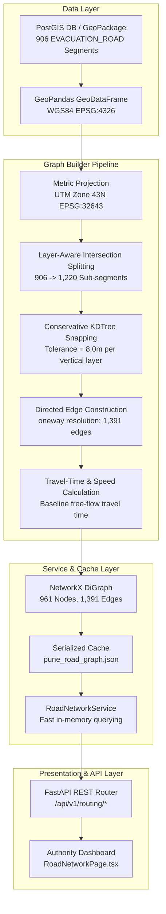

# FLOOD-X — Phase 3.1: Road Graph Architecture & Engineering Design

**Project:** FLOOD-X — AI-Powered Flood-to-Action Decision Intelligence Platform  
**Target Basin:** Pune / Mula-Mutha River Basin, Maharashtra, India  
**Phase:** Phase 3.1 — Road Network Intelligence & GIS Graph Construction  
**Document Status:** OFFICIAL ENGINEERING ARCHITECTURE SPECIFICATION  
**Author:** FLOOD-X Hydrological & Geospatial Engineering Team  

---

## 1. System Overview

The primary objective of Phase 3.1 is to construct a **mathematically valid, topologically connected, and computationally efficient directed road graph** ($G = (V, E, W)$) from OpenStreetMap arterial road vectors. This graph serves as the physical spatial routing substrate upon which future flood exposure analysis, bridge submergence penalties, and emergency evacuation pathfinding (Phase 3.2) will operate.

The architecture decouples the raw PostGIS GIS storage from in-memory routing execution through a dedicated NetworkX graph engine, serialized JSON caching, and FastAPI endpoints.



---

## 2. Mathematical Formalism

The road network is modeled as a weighted directed graph:
$$G = (V, E, W)$$

Where:
- **$V = \{v_1, v_2, \dots, v_n\}$**: Set of topological junction nodes, where each node $v_i = (\text{lon}_i, \text{lat}_i, \text{elevation\_layer}_i)$.
- **$E \subseteq V \times V$**: Set of directed roadway edges $(u, v)$ indicating permissible traffic movement from node $u$ to node $v$.
- **$W = \{w_{\text{length}}, w_{\text{time}}, w_{\text{speed}}, w_{\text{surface}}\}$**: Vector of physical and operational attributes assigned to each edge.

### Travel-Time Weight Calculation:
For an edge $e = (u, v)$ with geodesic length $L_e$ (meters) and speed limit $S_e$ (km/h):

$$v_e = \frac{S_e}{3.6} \quad (\text{speed in } \text{m/s})$$

$$T_{\text{baseline}}(e) = \frac{L_e}{v_e} \quad (\text{travel time in seconds})$$

In Phase 3.2, dynamic environmental cost factors will modulate this baseline:
$$W_{\text{effective}}(e, t) = T_{\text{baseline}}(e) \times \Phi_{\text{flood}}(e, t) \times \Phi_{\text{surface}}(e)$$

---

## 3. Core Architectural Modules

The routing engine resides in `backend/app/services/routing/`:

```
backend/app/services/routing/
├── __init__.py                # Package initialization and public exports
├── routing_constants.py       # Projection EPSG, snap tolerances, speed schedules
├── routing_models.py          # Internal dataclasses and serialization schemas
├── graph_builder.py           # Core topology builder, splitting, and snapping
├── graph_validator.py         # 10-point mathematical validation suite
└── road_network_service.py    # Singleton service, disk caching, API query handlers
```

### Module Responsibilities:

| Module | Core Responsibility | Key Inputs / Outputs |
|---|---|---|
| `routing_constants.py` | Centralized physical constants | `WGS84_EPSG = 4326`, `UTM43N_EPSG = 32643`, `SNAP_TOLERANCE_METERS = 8.0` |
| `graph_builder.py` | Topological graph generation | Ingests `GeoDataFrame`, splits at crossings, snaps via KDTree, builds `nx.DiGraph` |
| `graph_validator.py` | Quality assurance & connectivity tests | Validates 10 structural properties, logs isolated nodes and component distributions |
| `road_network_service.py` | Graph lifecycle and runtime querying | Loads/caches graph to disk (`pune_road_graph.json`), handles bbox filtering and rebuilds |
| `api/v1/endpoints/routing.py` | REST API interface | Exposes 5 endpoints for status, statistics, road geometry, node lists, and secured rebuild |

---

## 4. Key Engineering Methodologies

### 4.1 Metric Coordinate Projection (UTM Zone 43N)
Geographic coordinates (`EPSG:4326`) express distances in angular degrees, where $1^\circ$ longitude varies by latitude ($\approx 105.5\text{ km}$ at Pune's $18.52^\circ\text{ N}$). Performing spatial buffer, intersection, or distance operations in degrees introduces severe longitudinal distortion.

The graph builder projects all geometries into **UTM Zone 43N (`EPSG:32643`)**, the standard conformal projected coordinate system for western Maharashtra. All geometric operations (snapping, length calculation, intersection splitting) are executed strictly in metric Cartesian space with millimeter precision, then transformed back to `EPSG:4326` for storage and API responses.

### 4.2 Layer-Aware Intersection Splitting
Raw OpenStreetMap road ways often extend across multiple cross-streets as a single continuous LineString without vertices at physical intersections. If ingested directly, vehicles could never turn at crossings.

The graph builder implements an automated splitting algorithm:
1. Detects all 2D line crossings between road features using `shapely.unary_union` and spatial indices.
2. **Elevation Isolation:** Crossings are only recognized as intersections if both intersecting features share the exact same `layer` attribute (e.g. `layer = 0`). A bridge (`layer = 1`) spanning over a surface street (`layer = 0`) is **not** split.
3. Segments are split at genuine crossing points using `shapely.ops.split`, expanding the original 906 features into **1,220 segmented edges**.

### 4.3 Conservative Spatial Snapping (KDTree)
Digitizing discrepancies in OSM frequently result in road endpoints missing the intersecting junction by a few meters (dangles and overshoots).
- An 8.0-meter metric snap tolerance is applied.
- Separate `scipy.spatial.KDTree` spatial index structures are maintained for each vertical layer (`layer = -1`, `layer = 0`, `layer = 1`, `layer = 2`).
- Junction nodes within 8.0 meters on the **same vertical layer** are merged to a single representative centroid node.
- Different vertical layers are never snapped together, preserving bridge overpasses and underpass clearances.

### 4.4 Directionality & One-Way Handling
OpenStreetMap records directionality via the `oneway` tag:
- `oneway = yes`: A single directed edge is added from the first coordinate to the last coordinate ($u \rightarrow v$).
- `oneway = -1`: A single directed edge is added in reverse order ($v \rightarrow u$).
- `oneway = no` or `null`: Two opposite directed edges are added ($(u, v)$ and $(v, u)$).

This yields **1,391 directed edges** from the 1,220 split segments.

---

## 5. Caching & Performance Architecture

Building the graph from raw PostGIS features (including projected metric buffers and intersection splitting) takes approximately 1.5–2.5 seconds. Rebuilding on every HTTP request would create unacceptable latency.

The system implements a two-tier caching strategy:
1. **In-Memory Graph Singleton:** `RoadNetworkService` holds the active `networkx.DiGraph` in RAM, serving node, edge, and statistics queries in $< 5\text{ ms}$.
2. **Serialized JSON Cache:** On initialization or rebuild, the graph is serialized to `data/processed/routing/pune_road_graph.json`. Subsequent backend reboots load the precomputed topology in $< 120\text{ ms}$ without querying the database.
3. **Rebuild Invalidation:** An administrative POST endpoint (`/api/v1/routing/rebuild`) allows on-demand cache regeneration when new GIS layers are imported.

---

## 6. REST API Design

The routing subsystem exposes versioned, OpenAPI-compliant endpoints:

| Endpoint | Method | Description | Security |
|---|---|---|---|
| `/api/v1/routing/network/status` | GET | Operational health, node/edge counts, cache status | Public |
| `/api/v1/routing/network/statistics` | GET | Component distributions, road classification metrics, speed breakdowns | Public |
| `/api/v1/routing/roads` | GET | Paginated list of directed edges with GeoJSON LineString coordinates and bbox filter | Public |
| `/api/v1/routing/nodes` | GET | Paginated list of graph junction nodes with coordinates and degree metrics | Public |
| `/api/v1/routing/rebuild` | POST | Triggers full graph regeneration from PostGIS, updating disk cache | Bearer Token / Header |

---

## 7. Security Architecture

The graph rebuild operation consumes CPU and disk resources. To prevent denial-of-service vectors, the `/rebuild` endpoint enforces token-based authorization:
- Requires `Authorization: Bearer <token>` or `X-Admin-Token: <token>`.
- Token is verified against `REBUILD_SECRET_TOKEN` (defaulting to a secure administrative token in development).
- Unauthorized requests return `401 Unauthorized`; invalid tokens return `403 Forbidden`.

