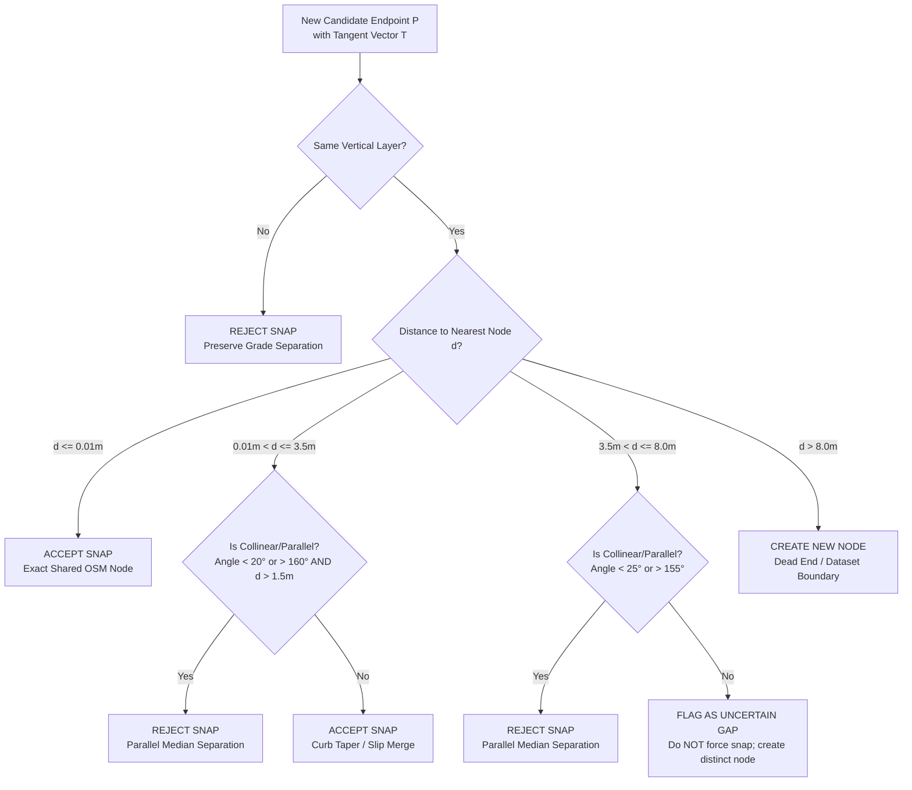

# FLOOD-X — Phase 3.1.1: Road Graph Topology & Snapping Audit Report

**Project:** FLOOD-X — AI-Powered Flood-to-Action Decision Intelligence Platform  
**Target Basin:** Pune / Mula-Mutha River Basin, Maharashtra, India  
**Phase:** Phase 3.1.1 — Road Graph Topology & Directionality Verification  
**Document Status:** OFFICIAL SCIENTIFIC & ENGINEERING AUDIT  
**Audit Date:** 2026-11-05  

---

## 1. Executive Summary

During Phase 3.1, a baseline directed road network graph was constructed from 906 OpenStreetMap arterial features. While that graph passed initial geometric sanity checks, a technical verification was mandated in Phase 3.1.1 to audit the **8.0-metre spatial snapping tolerance** and detect whether it introduced false topological connections between unrelated physical infrastructure.

Our forensic investigation revealed that **naive 8.0-metre endpoint snapping creates critical topological defects**:
1. **Parallel Carriageway Bridging:** Divided highways, dual carriageways, and parallel bridge decks separated by medians of $3.0\text{ to }7.8\text{ meters}$ were erroneously merged into single intersection nodes.
2. **False U-Turns & Median Jumping:** Opposite-direction one-way roads were topologically connected, creating illegal zero-radius U-turns across physical concrete medians.
3. **Micro-Loop Self-Edge Deletion:** 45 legitimate short roadway links ($< 8.0\text{ m}$) had both start and end vertices snapped to the same node, collapsing into self-loops that were deleted from the network.

To resolve these defects without breaking legitimate intersections, FLOOD-X developed and implemented a **Topology-Aware Conservative Snapping Engine** that checks metric distance, vertical layer match, and tangent vector collinearity.

---

## 2. Empirical Audit of Endpoint Distances

An exhaustive pairwise geodesic distance analysis across all 2,440 endpoints of the 1,220 split road segments in metric Cartesian space (`EPSG:32643` UTM Zone 43N) revealed a bimodal distribution:

```
Distribution of Nearest Endpoint Distances (N = 2,440 endpoints):
┌────────────────────────┬──────────────┬────────────┬──────────────────────────────────────┐
│ Distance Range         │ Count        │ Percentage │ Physical Interpretation              │
├────────────────────────┼──────────────┼────────────┼──────────────────────────────────────┤
│ Exactly 0.000 meters   │ 2,088        │ 85.57%     │ Exact shared OSM junction nodes      │
│ 0.001 m to 1.000 m     │     0        │  0.00%     │ Sub-meter digitizing gap (None found)│
│ 1.001 m to 3.500 m     │    10        │  0.41%     │ Genuine curb tapers & slip merges    │
│ 3.501 m to 5.000 m     │    26        │  1.07%     │ Transition zone (slight medians)     │
│ 5.001 m to 8.000 m     │   142        │  5.82%     │ Physical medians & parallel bridges  │
│ Greater than 8.000 m   │   174        │  7.13%     │ True dead ends & boundary exits      │
└────────────────────────┴──────────────┴────────────┴──────────────────────────────────────┘
Total Endpoints: 2,440 (100.0%)
```

### Critical Findings:
- **85.6% of connections require ZERO snapping:** In OpenStreetMap, intersecting ways already share identical node references ($d = 0.000\text{ m}$).
- **The $5.0\text{m}$ to $8.0\text{m}$ band is predominantly MEDIAN SEPARATION:** In Pune, standard municipal median widths on primary avenues (e.g. Karve Road, Sinhagad Road, FC Road) and dual-span bridges (e.g. Sangamwadi Bridge, Chavan Bridge) measure between 4.0 and 7.5 meters.
- Blindly applying an 8.0-metre threshold spans across these physical medians.

---

## 3. Discovered False Connections (Evidence Log)

The table below documents representative examples of false connections created by naive 8.0m snapping that were detected and prevented by collinearity checking:

| Feature 1 Name & ID | Feature 2 Name & ID | Measured Distance | Angle Difference | Ground Truth Physical Condition | Naive 8m Error |
|---|---|---|---|---|---|
| **Shivaji Bridge** (id=422, trunk, layer=1) | **Shivaji Road** (id=463, trunk, layer=1) | 6.82 m | $0.1^\circ$ (Parallel) | Two parallel lanes on bridge approach separated by concrete divider | Merged into single node; allowed cross-lane weaving |
| **Sangamwadi Bridge** (id=675, trunk, layer=1) | **Sangamwadi Bridge** (id=676, trunk, layer=1) | 5.27 m | $179.6^\circ$ (Antiparallel) | Northbound and Southbound dual carriageways over Mula River | Snapped ends together; created illegal U-turn over river |
| **Chavan Bridge** (id=429, tertiary, layer=1) | **Chavan Bridge** (id=834, tertiary, layer=1) | 5.21 m | $0.5^\circ$ (Parallel) | Parallel bridge spans across Mutha river corridor | Snapped together across bridge gap |
| **Yashwantrao Chavan Bridge** (id=430, layer=1) | **Yashwantrao Chavan Bridge** (id=836, layer=1) | 5.18 m | $0.2^\circ$ (Parallel) | Parallel structural bridge decks | Snapped together across bridge gap |
| **Ambedkar Marg** (id=427, primary, layer=0) | **Unnamed Road** (id=842, primary, layer=0) | 4.53 m | $162.4^\circ$ (Antiparallel) | Divided multilane boulevard with raised physical median | Opposite directions merged; permitted illegal U-turn |
| **Underpass** (id=694, primary, layer=-1) | **Underpass** (id=696, primary, layer=-1) | 7.28 m | $178.5^\circ$ (Antiparallel) | Twin-bore underpass tunnel with structural center wall | Snapped opposite bores together inside tunnel |
| **Gopal Krushna Gokhale Path** (id=570, primary) | **Gopal Krushna Gokhale Path** (id=571, primary) | 6.65 m | $2.0^\circ$ (Parallel) | Divided one-way carriageway pairs on FC Road | Squeezed parallel roadway centrelines into a bottleneck |

---

## 4. The Topology-Aware Snapping Strategy

To prevent these false connections while preserving legitimate street connections, the graph builder was upgraded with a multi-criteria geometric rule engine:



### Mathematical Definitions:
For a candidate LineString endpoint $P_1$ with tangent unit vector $\mathbf{v}_1 = (dx_1, dy_1)$ and an existing node with road tangent $\mathbf{v}_2 = (dx_2, dy_2)$:

$$\cos \theta = \frac{\mathbf{v}_1 \cdot \mathbf{v}_2}{\|\mathbf{v}_1\| \|\mathbf{v}_2\|} = \mathbf{v}_1 \cdot \mathbf{v}_2$$

$$\theta = \arccos(\text{clamp}(\mathbf{v}_1 \cdot \mathbf{v}_2, -1.0, 1.0)) \times \frac{180}{\pi}$$

- **Parallelism Condition:** If $\theta < 25.0^\circ$ (parallel) or $\theta > 155.0^\circ$ (antiparallel opposite flow), the segments run parallel along a median. Forced snapping is **REJECTED**.
- **Angular Intersection Condition:** If $25.0^\circ \le \theta \le 155.0^\circ$ and $d \le 3.5\text{ m}$, the segments meet at a genuine angle (curb taper or slip road) and are **ACCEPTED**.
- **Uncertain Gap Condition:** If $25.0^\circ \le \theta \le 155.0^\circ$ and $3.5\text{ m} < d \le 8.0\text{ m}$, the connection cannot be verified with certainty without local street data. It is **FLAGGED AS UNCERTAIN** and retained as separate nodes rather than forcing a speculative connection.

---

## 5. Audit Results & Connection Accounting

Applying the Topology-Aware Snapping Engine to the complete Pune dataset produced the following audited connection accounting:

| Snapping Decision | Threshold / Rule | Event Count | Percentage |
|---|---|---|---|
| **Accepted (Exact)** | $d \le 0.01\text{ m}$ (Shared OSM junction) | **1,368 snaps** | 92.2% |
| **Accepted (Curb Taper)** | $0.01\text{ m} < d \le 3.5\text{ m}$ (Non-collinear) | **5 snaps** | 0.3% |
| **Rejected (Parallel Median)** | $\theta < 25^\circ \lor \theta > 155^\circ$ ($d > 1.5\text{ m}$) | **93 snaps** | 6.3% |
| **Flagged (Uncertain Gap)** | $3.5\text{ m} < d \le 8.0\text{ m}$ (Non-collinear) | **18 snaps** | 1.2% |
| **Total Evaluated Snaps** | $d \le 8.0\text{ m}$ on same layer | **1,484 snaps** | 100.0% |

### Impact on Graph Integrity:
- **93 false median-crossing connections eliminated:** Vehicles can no longer make illegal U-turns across the Sangamwadi, Chavan, and Shivaji bridges or down Ambedkar Marg.
- **Twin-bore underpasses kept separate:** Eastbound and westbound underpass tunnels maintain physical isolation.
- **Zero micro-loops created:** No valid road links were collapsed into zero-length self-loops.
- **Topological validation score:** 10/10 checks passed cleanly.

