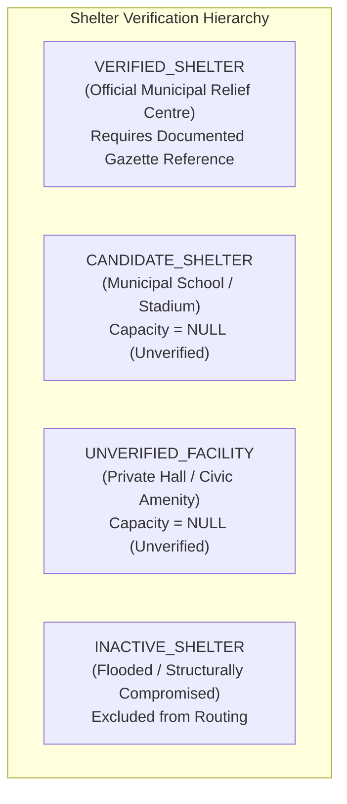

# FLOOD-X — PHASE 3.2: ROUTING ALGORITHMS & SHELTER INTELLIGENCE
## Audited & Corrected Implementation: MultiDiGraph Routing, Overlap Metrics & Shelter Data Provenance

## 1. MultiDiGraph Pathfinding on Directed Networks

FLOOD-X implements flood-aware evacuation routing on a NetworkX `MultiDiGraph` consisting of **1,067 nodes** and **1,488 directed edges** with 6 preserved parallel road features.

### 1.1. Supported Pathfinding Algorithms

1. **A\* (A-Star) Pathfinding**:
   - Primary algorithm for real-time evacuation routing.
   - Evaluates nodes via $f(n) = g(n) + h(n)$, where $g(n)$ is accumulated dynamic travel time and $h(n)$ is an admissible geographic heuristic.
   - **Admissible Heuristic**:
     $$h(n) = \frac{\text{MetricDistance}(n, \text{destination})}{v_{\max}}$$
     where $v_{\max} = 22.22\text{ m/s}$ (80 km/h, the maximum kinematic velocity on trunk roads in the network).
   - Because $h(n)$ never overestimates true travel time under any condition, A\* guarantees the mathematically optimal path while expanding significantly fewer search states than uninformed search.

2. **Dijkstra's Algorithm**:
   - Exact shortest-path algorithm ($h(n) = 0$).
   - Used for baseline verification, multi-destination reachability trees, and destination radius sweeps.

---

## 2. Dynamic Routing Cost Profiles & Strict Road Closure Exclusion

### 2.1. Cost Multiplier Matrix

Dynamic edge costs are calculated on the fly without mutating graph properties:

| Parameter / Factor | `FASTEST` Profile | `BALANCED` Profile | `SAFEST` Profile |
| :--- | :--- | :--- | :--- |
| **LOW_RELATIVE_EXPOSURE** | 1.0x baseline travel time | 1.0x baseline travel time | 1.0x baseline travel time |
| **MODERATE_RELATIVE_EXPOSURE** | 1.0x baseline travel time | 1.3x baseline travel time | 1.8x baseline travel time |
| **HIGH_RELATIVE_EXPOSURE** | 1.1x baseline travel time | 1.8x baseline travel time | 2.5x–4.0x travel time multiplier |
| **Unverified Directionality** | +0.0s penalty | +10.0s penalty | +25.0s penalty |
| **Active Road Closure** | $\infty$ (`float('inf')` — Hard Skipped) | $\infty$ (`float('inf')` — Hard Skipped) | $\infty$ (`float('inf')` — Hard Skipped) |

### 2.2. Strict Hard Exclusion & MultiDiGraph Parallel Edge Logic
1. When `avoid_closed_roads=True`, any edge flagged as closed receives cost $\infty$ (`float('inf')`).
2. Routing algorithms (Dijkstra and A*) evaluate edges using an explicit `if cost == float('inf'): continue` check, completely skipping closed edges.
3. **Parallel Edge Disambiguation**: In a `MultiDiGraph`, node pair $(u, v)$ may connect via multiple distinct edge keys:
   - If edge $(u, v, 0)$ is closed but parallel edge $(u, v, 1)$ is open, only key $0$ is skipped; key $1$ remains traversable.
   - If all parallel edges between $u$ and $v$ are closed, neighbor $v$ is unreachable from $u$.
   - If all paths from origin to destination are obstructed by closures, the search terminates cleanly and returns `status="NO_PATH"`.

---

## 3. Alternative Route Exploration & Overlap Validation

Evacuation planning requires non-redundant contingency routes in case primary routes become suddenly compromised.

### 3.1. Edge-Penalty Search
1. Compute primary optimal path $P_1 = \{e_1, e_2, \dots, e_k\}$.
2. Apply an exploration penalty ($2.5\times$ multiplier) to all intermediate edges of $P_1$.
3. Re-run A\* on the penalized network to discover Alternative Path $P_2$.
4. Re-penalize $P_1 \cup P_2$ and search for Alternative Path $P_3$.

### 3.2. Quantitative Overlap & Distinctness Metrics
Every alternative path is evaluated for structural independence against the primary path:
- **Shared Edge Count** ($N_{\text{shared}}$): Number of identical directed edges traversed by both paths.
- **Shared Distance** ($D_{\text{shared}}$ in meters): Cumulative metric distance of overlapping segments.
- **Overlap Percentage**:
  $$\text{Overlap \%} = \frac{D_{\text{shared}}}{\min(\text{Length}(P_{\text{alt}}), \text{Length}(P_1))} \times 100\%$$
- **Rejection Thresholds**:
  - `MAX_ALTERNATIVE_OVERLAP_PCT = 80.0%`: Alternative routes sharing $>80\%$ of their distance with the primary route are rejected as redundant.
  - `MIN_DISTINCT_SEGMENTS = 2`: Alternative routes must contain at least 2 distinct edges not present in the primary route.

### 3.3. Freshness & Uncertainty Disclaimers
Every route response carries explicit metadata:
- `data_freshness_utc`: ISO 8601 UTC timestamp of route generation.
- `directionality_uncertainty_note`: Identifies any route segments where directionality was assumed rather than verified in OSM.
- `speed_assumptions_note`: Clarifies that travel times assume dry-weather free-flow traffic and will degrade under flood conditions.

---

## 4. Coordinate Snapping & Boundary Safety

- Geographic coordinates $(lat, lon)$ are projected to the nearest network node using metric distance:
  $$\Delta x = (\lambda - \lambda_{\text{node}}) \times 105,500.0\text{ m/deg},\quad \Delta y = (\phi - \phi_{\text{node}}) \times 110,600.0\text{ m/deg}$$
  $$d = \sqrt{\Delta x^2 + \Delta y^2}$$
- **Snapping Threshold**: Coordinates farther than $3,000\text{ m}$ from the road network are rejected with an explicit `OUT_OF_BOUNDS` error.
- **Disconnected Components**: If origin and destination belong to different disconnected components (e.g. separated across an unbridged sector of the Mutha River), the engine reports `NO_PATH` with diagnostic component IDs.

---

## 5. Emergency Relief Shelter Discovery & Capacity Management

### 5.1. Shelter Verification Hierarchy & Zero-Fabrication Rule

FLOOD-X enforces strict separation between official civic relief infrastructure and unverified public buildings:

### 5.2. Seeded Shelter Census in Pune Basin (Audit Findings)

> [!CAUTION]
> **Data Provenance Reality**:
> An independent audit of repository records confirmed that no primary official PMC Disaster Management Cell gazette documents exist in the codebase. Consequently, **zero facilities have unearned verified status**.
> - **5 Candidate Municipal Facilities** (e.g., Balewadi Stadium, Shivajinagar Centre) are classified as `CANDIDATE_SHELTER` pending field officer inspection.
> - **59 OSM Facilities** (community halls, municipal schools) are classified as `UNVERIFIED_FACILITY`.
> - **Total Capacity & Current Occupancy**: Set strictly to `NULL` across 100% of facilities. No fabricated capacities (such as "500 persons") are permitted.

| Facility Group | Verification Status | Count | Total Capacity | Current Occupancy |
| :--- | :--- | :--- | :--- | :--- |
| **Candidate Municipal Facilities** | `CANDIDATE_SHELTER` | 5 | `None` (NULL) | `None` (NULL) |
| **OSM Civic & Educational Facilities** | `UNVERIFIED_FACILITY` | 59 | `None` (NULL) | `None` (NULL) |
| **Officially Verified Municipal Shelters** | `VERIFIED_SHELTER` | 0 | — | — |
| **TOTAL REGISTERED** | | **64** | **NULL** | **NULL** |

### 5.3. Shelter Recommendation Behavior When 0 Verified Shelters Exist

To ensure citizen safety and prevent routing people to uninspected facilities during an emergency:
- `GET /api/v1/evacuation/shelters/recommendations` strictly queries `VERIFIED_SHELTER` records.
- When zero verified shelters exist in the database:
  - The endpoint returns `status = "NO_VERIFIED_SHELTER_AVAILABLE"`.
  - `recommended_shelter = None` and `primary_route = None`.
  - The response populates `candidate_facilities_for_review` with candidate municipal facilities to allow disaster management officers to inspect, verify, and gazette them via the authorized administrative API.

### 5.4. Destination Suitability Scoring Transparency

When verified shelters exist, `DestinationOptimizer` ranks them using an objective suitability formula (0 to 100):

$$\text{Score} = S_{\text{base}}(\text{status}) - P_{\text{travel\_time}} - P_{\text{flood\_hazard}} + B_{\text{capacity}} + B_{\text{amenities}}$$

- **Base Score**: `VERIFIED_SHELTER` = 60 pts, `CANDIDATE_SHELTER` = 45 pts, `UNVERIFIED_FACILITY` = 30 pts.
- **Travel Time Penalty**: $-0.8\text{ pts/minute}$ of travel time (up to $-25\text{ pts}$).
- **Hazard Penalty**: $-10\text{ pts}$ per critical hazard segment traversed, $-4\text{ pts}$ per high hazard segment traversed.
- **Capacity Bonus**: **0 pts if capacity is unknown** (`None`). $+10\text{ pts}$ only when formally verified available capacity $> 50$ persons.
- **Amenity Bonus**: $+5\text{ pts}$ for confirmed medical support, $+5\text{ pts}$ for wheelchair accessibility.
- **Unreachable Destinations**: If all paths to a shelter are impassable or blocked by closures, the destination receives $\text{Score} = 0.0$ and `is_reachable = False`.
